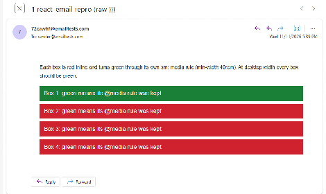
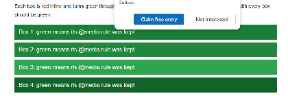

# Bug Report — `<Tailwind>`: Outlook.com ignores every media query after the first, because the generated `<style>` has adjacent `}}`

> Fill into https://github.com/resend/react-email/issues/new (Bug Report form).
> Field labels below match the template exactly. Label `Type: Bug` is applied automatically.

---

## What versions are you using? (if relevant)

`react-email@6.11.11` (bundled `<Tailwind>` / `render`), `tailwindcss@4.3.5` (latest of both at time of writing)

## Describe the Bug

Outlook.com deletes everything in a `<style>` element that comes after two adjacent closing braces, `}}`. This is a long-standing client bug, documented in [hteumeuleu/email-bugs#92](https://github.com/hteumeuleu/email-bugs/issues/92). The documented workaround is any whitespace between the braces (`} }`).

`<Tailwind>` puts every non-inlinable rule in its own `@media` block and writes the stylesheet minified (`generate(nonInlineStyles)` in [`tailwind.tsx`](https://github.com/resend/react-email/blob/main/packages/react-email/src/components/tailwind/tailwind.tsx)). Every block ends in `}}` and they all share one `<style>`, so Outlook.com keeps the first `@media` block and drops the rest.

In practice only one responsive (`sm:`, `md:`, …) or `dark:` rule per email works in Outlook.com. Columns that sit side by side through `sm:` widths stay stacked at desktop width, and only the first dark-mode colour applies. I've also seen the same thing in Outlook on the web with a Microsoft 365 mailbox and in the new Outlook for Windows.

The CSS is valid, so strictly this is Outlook's bug. But `<Tailwind>` already adapts its output for email clients ([`downlevel-for-email-clients.ts`](https://github.com/resend/react-email/blob/main/packages/react-email/src/components/tailwind/utils/css/downlevel-for-email-clients.ts)), and fixing it there would cover everyone who uses responsive or `dark:` classes. `render(..., { pretty: true })` doesn't help: the `<style>` contents keep their `}}`.

**Suggested fix:** when writing the non-inlinable stylesheet, put whitespace between adjacent closing braces (`} }`). Merging identical media queries would not be enough on its own: with two different queries (a breakpoint and `dark:`), the second block still comes after a `}}`.

## What is affected (leave empty if unsure)

- Tailwind Component

## Link to the code that reproduces this issue

`https://github.com/lpolito/react-email-outlook-double-brace`

Minimal, self-contained (react-email + tailwindcss only). Core of [`render.tsx`](render.tsx):

```tsx
import { Body, Head, Html, render, Tailwind } from "react-email";

// Four boxes, each red inline and turned green by its own `sm:` rule.
const Email = () => (
  <Tailwind>
    <Html>
      <Head />
      <Body>
        <div className="bg-[#cf222e] sm:bg-[#1a7f37]">Box 1</div>
        <div className="bg-[#cf222e] sm:bg-[#1f883d]">Box 2</div>
        <div className="bg-[#cf222e] sm:bg-[#2da44e]">Box 3</div>
        <div className="bg-[#cf222e] sm:bg-[#116329]">Box 4</div>
      </Body>
    </Html>
  </Tailwind>
);

const html = await render(<Email />);
```

## To Reproduce

```bash
npm install
npm run render
```

This writes `out/raw.html` (react-email's output, unchanged) and `out/spaced.html` (the same, with one space between each pair of adjacent closing braces inside `<style>`). The generated `<style>`:

```css
@media (min-width: 40rem) {
  .sm_bg-_1a7f37 {
    background-color: rgb(26, 127, 55) !important;
  }
}
@media (min-width: 40rem) {
  .sm_bg-_1f883d {
    background-color: rgb(31, 136, 61) !important;
  }
}
@media (min-width: 40rem) {
  .sm_bg-_2da44e {
    background-color: rgb(45, 164, 78) !important;
  }
}
@media (min-width: 40rem) {
  .sm_bg-_116329 {
    background-color: rgb(17, 99, 41) !important;
  }
}
```

Open both in Outlook.com at desktop width (I used Litmus's Outlook.com client in Chrome).

**`out/raw.html`**: box 1 is green, boxes 2–4 stay red.



**`out/spaced.html`**: all four are green. (A Microsoft promo pop-up covers part of the top.)



## Expected Behavior

Every `@media` block that `<Tailwind>` generates survives in Outlook.com, so all four boxes are green at desktop width.

## What's your node version? (if relevant)

v24.18.0
